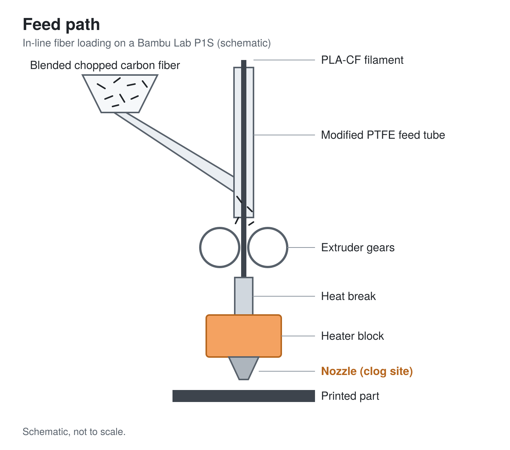
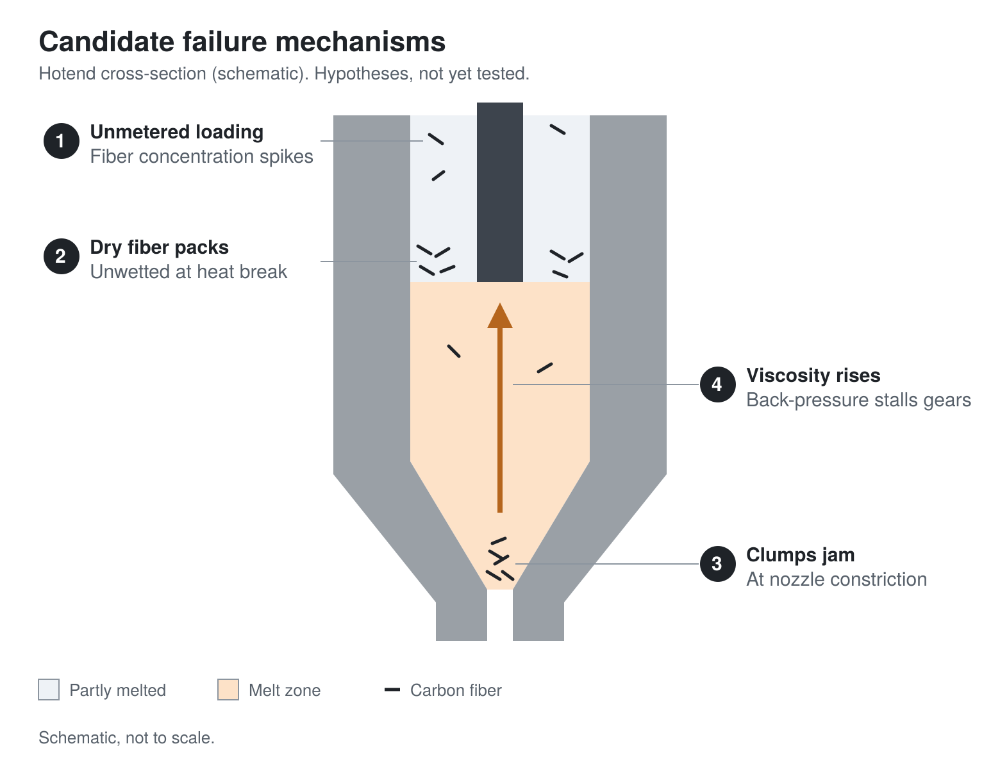
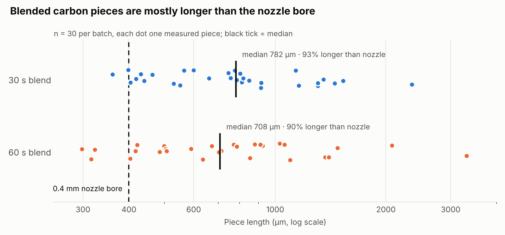
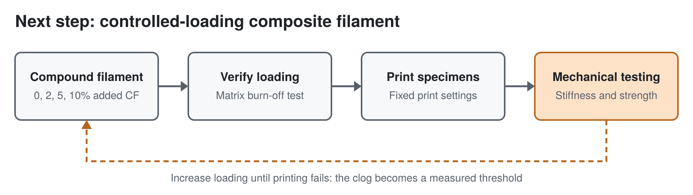

[README.md](https://github.com/user-attachments/files/34601495/README.md)
# In-Line Carbon Fiber Loading of PLA-CF on a Desktop FDM Printer: A Failure Analysis

**Peter Cohan** · Home lab experiment · Write-up reconstructed afterward (see [Documentation note](#documentation-note))
[flake_measurements.csv](https://github.com/user-attachments/files/34601497/flake_measurements.csv)

## Abstract[flake_measurements.csv](https://github.com/user-attachments/files/34601503/flake_measurements.csv)

Commercial carbon-fiber-filled PLA (PLA-CF) carries a fixed fiber loading set by the manufacturer. I tried to raise the effective fiber content of printed parts without making custom filament. I fed chopped carbon fiber, blended to a near-powder, into a modified PTFE feed tube on a Bambu Lab P1S, where it was drawn into the hotend with the PLA-CF filament. Some additional carbon was deposited into the print, which showed that in-line loading is physically possible. The hotend then clogged, and the clog destroyed the print head. My leading explanation is that dry, unwetted, unmetered fiber entered the melt zone, agglomerated, and jammed at the nozzle constriction while also raising melt viscosity past what the extruder could push. A follow-up measurement of re-blended fiber (n = 60) found that about 92% of pieces were longer than the 0.4 mm nozzle bore, and that doubling blend time from 30 s to 60 s produced no detectable reduction in length. The failure showed that fiber has to be dispersed in the polymer *before* it reaches the hotend. That conclusion led directly to my next project: a desktop filament extruder for compounding composite filament at controlled, measured fiber loadings.

## Motivation and Hypothesis

Short carbon fibers stiffen a polymer by carrying load across the matrix. More fiber should give a stiffer part, up to a point. Commercial PLA-CF fixes that loading, and making custom filament takes equipment I didn't have at the time.

**Hypothesis:** Adding chopped carbon fiber in-line with PLA-CF filament would raise the fiber content of the printed part and increase its stiffness, without manufacturing new filament.

## Setup

| Item | Detail |
|---|---|
| Printer | Bambu Lab P1S |
| Base filament | PLA-CF |
| Additive | 1/4" chopped carbon fiber, blended to near-dust |
| Feed method | Modified PTFE feed tube; loose fiber was drawn into the extruder alongside the filament |

## Result

- Some additional carbon fiber made it through the hotend and into the printed part.
- The hotend then clogged. The clog destroyed the print head.

## Failure Analysis

These are hypotheses, not confirmed causes. I didn't instrument the experiment, so I can't separate them yet. Each one is listed with how it could be tested.

**1. Unmetered loading.**
The fiber went in by being dragged along with the filament, so nothing controlled how much entered at any moment. Local fiber concentration could spike far above the average.
*Test:* Repeat with a metered feed and see whether failure depends on feed rate.

**2. Dry fiber was never wetted by the polymer.**
In commercial PLA-CF, every fiber is already surrounded by polymer, so the melt flows like a suspension. Loose dry fiber has no polymer coating. It can pack together as a dry mass instead of flowing, especially in the heat break, where the plastic is only partly melted.
*Test:* Inspect a sectioned nozzle and heat break. Packed dry fiber versus fiber embedded in plastic shows where the jam formed.

**3. Agglomeration at the nozzle constriction.**
Blending makes fibers shorter but does not separate them, so clumps can easily be larger than the nozzle bore. Particle-laden flows tend to jam at a constriction once particles or clumps approach a meaningful fraction of the orifice diameter, especially at high solids content.
*Test:* Measure the fiber length distribution of the blended fiber and compare it to the nozzle diameter. **Done: see [Follow-up Measurement](#follow-up-measurement-blended-piece-size). Result supports this hypothesis.**

**4. Melt viscosity exceeded what the extruder could push.**
Short fiber raises a polymer melt's viscosity, and PLA-CF already contains fiber. Adding more raises back-pressure until the extruder gears can no longer drive the filament.
*Test:* Compare extrusion force or flow rate at increasing fiber loadings, using controlled-loading filament.

## Follow-up Measurement: Blended Piece Size

To test hypothesis 3, I re-blended carbon and measured the size of the resulting pieces.

**Method**
- Two batches, each 20 g carbon with 5 g water: one blended 30 s, one blended 60 s
- Pieces were re-dried out of the slurry, then measured by video analysis (Vernier), with the scale set from a 0.1 mm length measured with calipers
- 30 pieces measured per batch, length and width; piece thickness was approximately 75 µm
- Raw data: [`flake_measurements.csv`](flake_measurements.csv)

| | 30 s blend | 60 s blend |
|---|---|---|
| Median length | 782 µm | 708 µm |
| Middle 50% of lengths | 535–1082 µm | 500–1003 µm |
| Longest piece | 2355 µm | 3315 µm |
| Longer than 0.4 mm nozzle | 93% | 90% |
| Median width | 236 µm | 237 µm |

**Findings**
1. **Almost every piece is longer than the nozzle bore.** About 92% of all 60 pieces exceeded 400 µm, and the median width (about 236 µm) is more than half the bore. Pieces this size can bridge across the converging section of the nozzle, which supports hypothesis 3 as a cause of the clog.
2. **Blending did not separate the fiber.** Pieces are hundreds of microns wide and about 75 µm thick. Individual carbon filaments are typically around 7 µm in diameter, so each piece is a bundle of many filaments stuck together, not loose fibers. That fits hypotheses 2 and 3.
3. **Longer blending didn't help.** Doubling blend time from 30 s to 60 s produced no statistically detectable change in length or width (Mann-Whitney U test, p ≈ 0.66 for length). The length distributions are right-skewed with long tails, as expected for mechanically broken material.

**Limitations**
- 30 pieces per batch can only detect large differences between blend times. A small effect could still exist.
- Pieces were picked by eye from video, which tends to miss the finest particles, so the true distribution likely has more small pieces than measured.
- These batches were re-made for this test, so they approximate, rather than directly sample, the fiber used in the original run.

## What I Would Do Differently

The core problem is that the fiber met the polymer for the first time inside the hotend. The fix is to compound the fiber into the polymer beforehand, at a known weight fraction, and then print normal filament. My plan:

1. Build a desktop filament extruder and use it to make composite filament at controlled loadings (for example 0%, 2%, 5%, 10% added fiber).
2. Check actual fiber content with a matrix burn-off test (burning away the polymer and weighing the remaining fiber, the same principle as ASTM D2584 ignition-loss testing).
3. Measure stiffness and strength of printed parts on a custom-built test rig.
4. Find the loading at which printing fails, so the clog becomes a measured threshold instead of an accident.

## Documentation Note

I didn't document this experiment while I ran it. This write-up was reconstructed afterward from memory. Details I don't remember precisely, such as fiber quantity, print settings, and time to failure, are left out rather than estimated. Not recording data in real time is one of the lessons of this experiment, and I now keep a lab log for every project.

batch,blend_time_s,width_um,length_um
1,30,303,418
1,30,247,565
1,30,98,1160
1,30,291,1137
1,30,287,404
1,30,253,849
1,30,194,746
1,30,224,440
1,30,164,756
1,30,222,914
1,30,267,431
1,30,510,661
1,30,321,812
1,30,190,803
1,30,202,916
1,30,132,786
1,30,148,1305
1,30,165,1529
1,30,147,2355
1,30,284,529
1,30,139,361
1,30,346,1306
1,30,326,1353
1,30,214,398
1,30,308,777
1,30,117,463
1,30,253,818
1,30,260,1451
1,30,273,551
1,30,215,600
2,60,386,714
2,60,395,403
2,60,283,298
2,60,184,499
2,60,422,504
2,60,200,1029
2,60,120,1098
2,60,158,509
2,60,118,702
2,60,350,635
2,60,168,590
2,60,194,771
2,60,158,323
2,60,253,3315
2,60,167,421
2,60,236,417
2,60,130,507
2,60,245,786
2,60,222,854
2,60,283,2078
2,60,238,1478
2,60,309,672
2,60,486,1367
2,60,116,924
2,60,128,1398
2,60,248,316
2,60,323,1059
2,60,224,911
2,60,311,880
2,60,277,485

